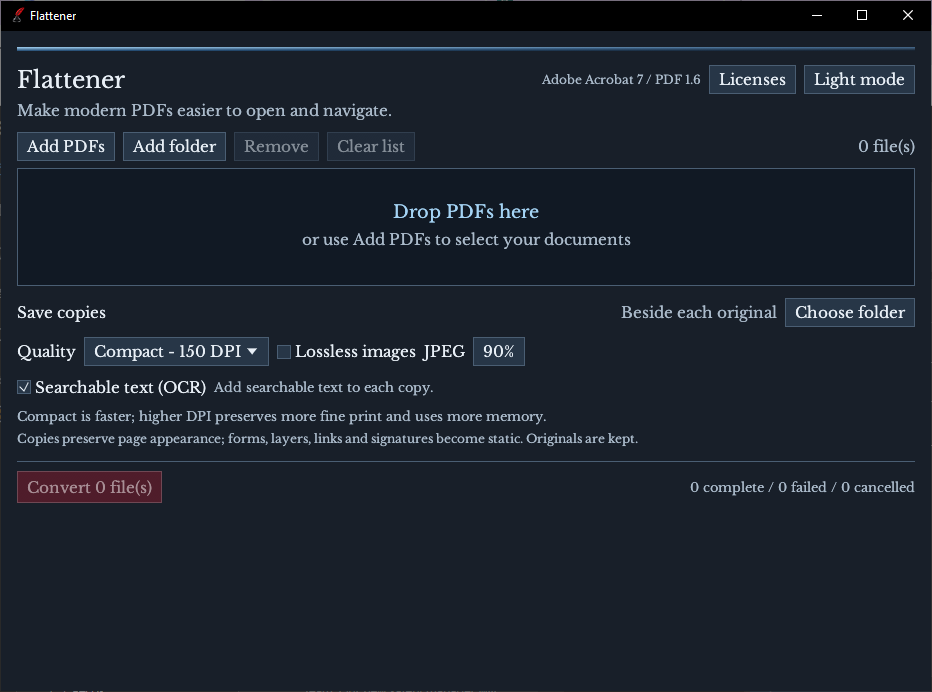
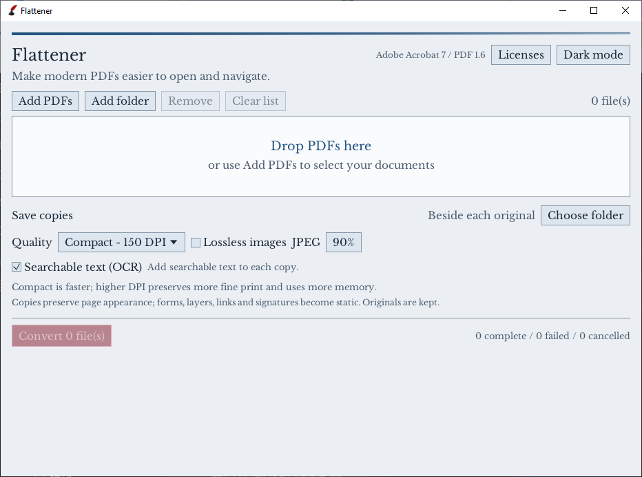

# Flattener: technician guide

Flattener makes a new PDF that older Acrobat viewers can display with less work. Your original file stays in place. The converted copy contains a fixed image of each page and, when enabled, a new searchable text layer.

## I. Choose the files

Open Flattener and select **Add PDFs**, or drag PDFs into the window. **Add folder** adds PDFs directly inside the chosen folder. Check the queue before starting.

## II. Choose the output

Leave the destination beside each original, or select an output folder. Converted filenames end in `_Acrobat7.pdf`. Existing files are never replaced; the desktop interface chooses an available numbered name when necessary.

## III. Choose quality

| Setting | Useful for |
| --- | --- |
| Compact, 150 DPI | Quick opening and large drawings; the starting setting |
| Balanced, 200 DPI | Smaller drawings and ordinary documents with finer text |
| Detail, 300 DPI | Small print and smaller sheets when additional detail matters |
| Lossless images | Avoiding JPEG artifacts around fine linework; potentially larger files |
| Searchable text | Offline recognition of Latin-script text so Acrobat can search and copy it |

More DPI needs more memory and usually creates larger files. A page may exceed the pixel limit at a higher setting. Lower the DPI and retry; Flattener does not silently change the selected resolution.

OCR can misread equipment tags, dimensions and numbers. Use the visible page as the reference for measurements and critical values. Turning OCR off makes an image-only PDF and is usually faster.

## IV. Convert and review

Select **Convert**. The queue shows the current stage and completed pages. **Cancel** stops the active conversion; completed copies remain available and unfinished files are not published.

Open the converted copy in Acrobat and check small text, linework, colors, stamps, and page orientation. Try a search when searchable text was enabled. Read any warnings in the file details. A completed file with warnings needs visual review.

Do not use rasterized drawing lines as a substitute for original vector precision. The page dimensions are preserved, but page content is now pixels. Interactive fields, editable layers, links, signatures and attachments do not remain interactive in the copy. Keep the original for editing or signature validation.

## V. Change the appearance

Use the **Dark / Light** control in the header. Flattener remembers the selected mode.

## VI. When a file fails

| Message or symptom | Next step |
| --- | --- |
| Password protected or encrypted | Use an authorized PDF application to save an unencrypted copy first |
| XFA form, portfolio, 3D or multimedia | Export ordinary PDF pages, or extract the individual documents |
| Page exceeds pixel limit | Select a lower DPI |
| Input exceeds 512 MiB | Split the source into smaller PDFs |
| Output exists or is locked | Choose another name or close the destination file |
| Cannot create temporary output | Check free space and write permissions in the output folder |
| Rendering warning or missing content | Compare against the source; try a conventional PDF export from the authoring application |
| OCR found no words | The file is still a visual copy; use clearer source material or an appropriate higher DPI |

Some modern PDF features cannot be reproduced by the Rust renderer. A filename or PDF version alone cannot prove that every page rendered correctly.
